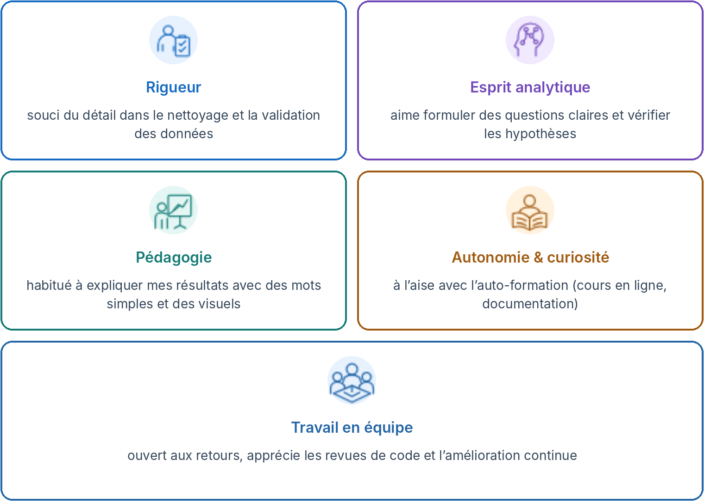
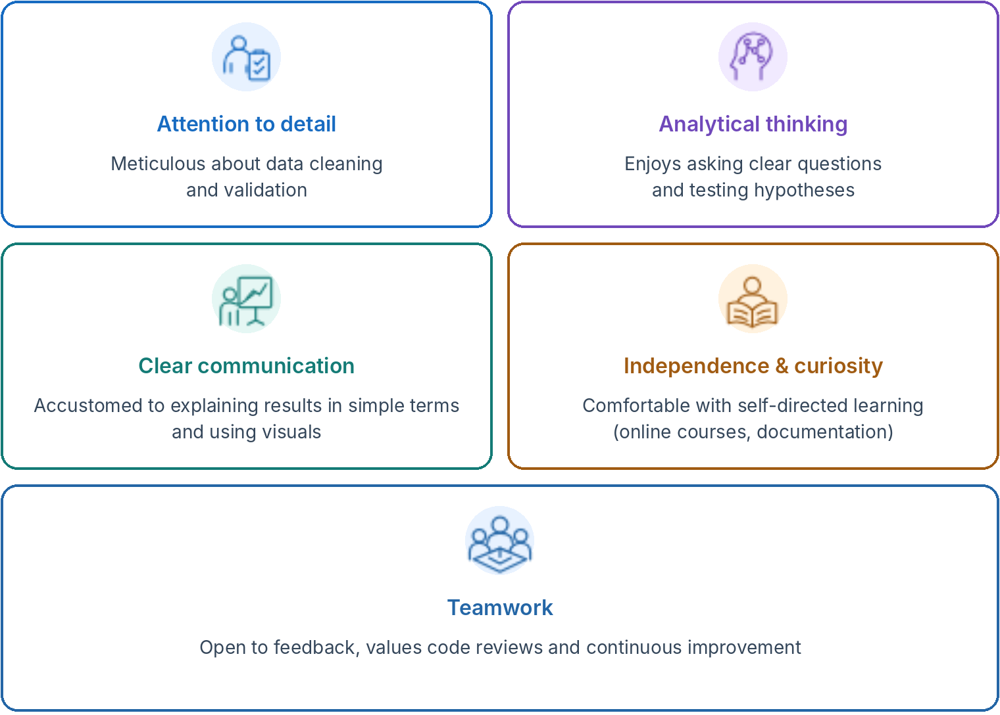
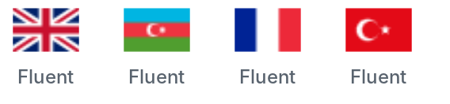

## Qui suis-je ?

Salut ! 👋 Je suis **Anar MEHTIYEV**.

Je me forme à l’analyse de données pour aider à la prise de décision : nettoyage de données, analyses statistiques, modélisation, visualisation et présenter les résultats de façon compréhensible pour les décideurs.

## Compétences techniques

<!-- Original HTML table (editable source)
<table>
  <thead><tr><th>Catégorie</th><th>Spécialité</th><th>Technologies</th></tr></thead>
  <tbody>
    <tr><td rowspan="2"><strong>Langages</strong></td><td>Programmation</td><td>Python</td></tr>
    <tr><td>Requêtes</td><td>SQL</td></tr>
    <tr><td rowspan="7"><strong>Bibliothèques</strong></td><td>Manipulation des données</td><td>Pandas</td></tr>
    <tr><td>Calcul numérique</td><td>NumPy · SciPy</td></tr>
    <tr><td>Calcul symbolique</td><td>SymPy</td></tr>
    <tr><td>Modélisation statistique</td><td>Statsmodels</td></tr>
    <tr><td>Machine Learning</td><td>Scikit-learn</td></tr>
    <tr><td>Deep Learning</td><td>TensorFlow</td></tr>
    <tr><td>Visualisation</td><td>Matplotlib · Seaborn</td></tr>
    <tr><td rowspan="3"><strong>Logiciels</strong></td><td>Analyse statistique</td><td>SAS</td></tr>
    <tr><td>Tableur</td><td>Microsoft Excel</td></tr>
    <tr><td>Business Intelligence</td><td>Microsoft Power BI · Tableau</td></tr>
    <tr><td rowspan="1"><strong>Environnements</strong></td><td>Calcul interactif</td><td>Jupyter Notebook</td></tr>
  </tbody>
</table>
-->

## Soft skills & façon de travailler

## Langues

<picture>
  <source media="(prefers-color-scheme: dark)" srcset="./langues-dark.png">
  
</picture>

## Me contacter

&nbsp; <a href="mailto:anar.mehtiyev.pro@gmail.com">anar.mehtiyev.pro@gmail.com</a>

&nbsp; <a href="https://www.linkedin.com/in/anarmehtiyev/">linkedin.com/in/anarmehtiyev ↗</a>

---

## Who am I?

Hi! 👋 I'm **Anar MEHTIYEV**.

I am developing my data analysis skills to support decision-making: data cleaning, statistical analysis, modelling, visualisation, and communicating results clearly to decision-makers.

## Technical skills

<!-- Original HTML table (editable source)
<table>
  <thead><tr><th>Category</th><th>Specialty</th><th>Technologies</th></tr></thead>
  <tbody>
    <tr><td rowspan="2"><strong>Languages</strong></td><td>Programming</td><td>Python</td></tr>
    <tr><td>Querying</td><td>SQL</td></tr>
    <tr><td rowspan="7"><strong>Libraries</strong></td><td>Data manipulation</td><td>Pandas</td></tr>
    <tr><td>Numerical computing</td><td>NumPy · SciPy</td></tr>
    <tr><td>Symbolic computing</td><td>SymPy</td></tr>
    <tr><td>Statistical modelling</td><td>Statsmodels</td></tr>
    <tr><td>Machine Learning</td><td>Scikit-learn</td></tr>
    <tr><td>Deep Learning</td><td>TensorFlow</td></tr>
    <tr><td>Visualisation</td><td>Matplotlib · Seaborn</td></tr>
    <tr><td rowspan="3"><strong>Software</strong></td><td>Statistical analysis</td><td>SAS</td></tr>
    <tr><td>Spreadsheets</td><td>Microsoft Excel</td></tr>
    <tr><td>Business Intelligence</td><td>Microsoft Power BI · Tableau</td></tr>
    <tr><td rowspan="1"><strong>Environments</strong></td><td>Interactive computing</td><td>Jupyter Notebook</td></tr>
  </tbody>
</table>
-->

## Soft skills & working style

## Languages

<picture>
  <source media="(prefers-color-scheme: dark)" srcset="./langues-en-dark.png">
  
</picture>

## Contact me

&nbsp; <a href="mailto:anar.mehtiyev.pro@gmail.com">anar.mehtiyev.pro@gmail.com</a>

&nbsp; <a href="https://www.linkedin.com/in/anarmehtiyev/">linkedin.com/in/anarmehtiyev ↗</a>

